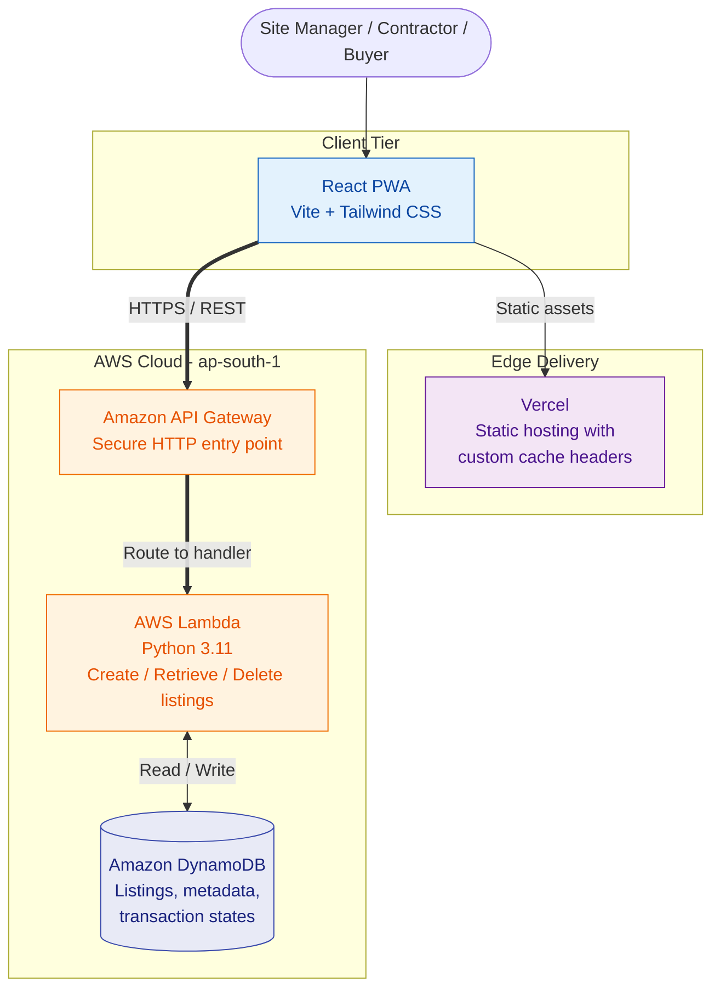
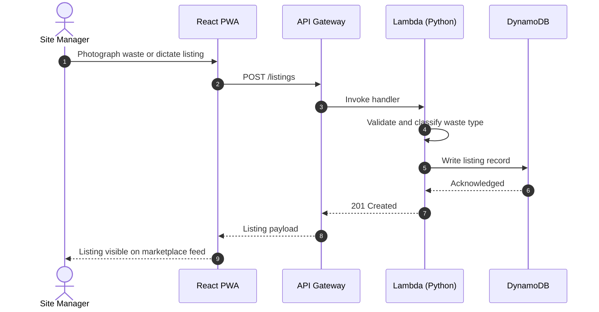
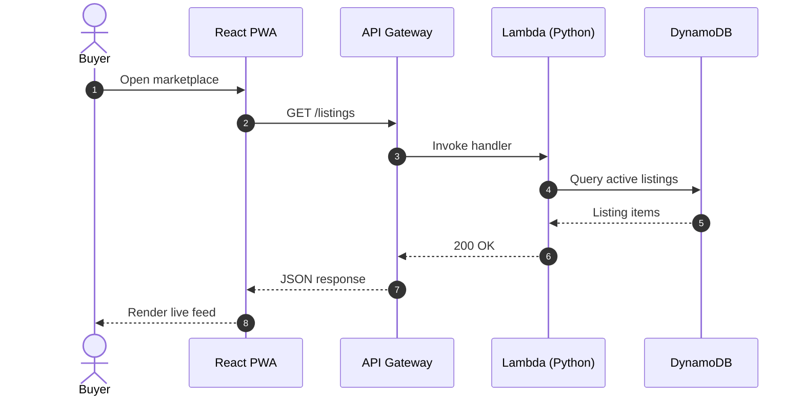
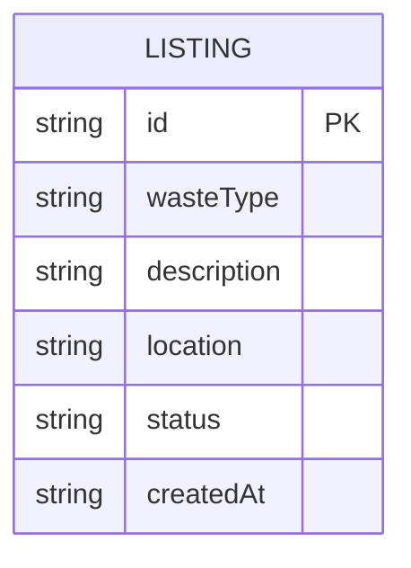
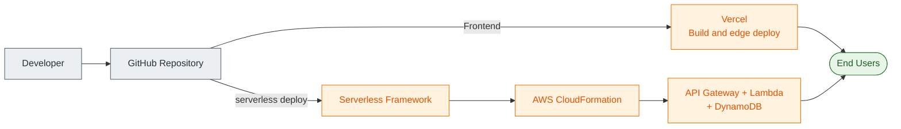

<div align="center">

# EcoBuild

### Construction & Demolition (C&D) Waste Marketplace

**A serverless, real-time, hyperlocal marketplace that connects construction sites, contractors and recycling buyers, and dispatches the transport to move the material.**

[](https://aws-hackathon-dtu-eight.vercel.app)
[](#architecture)


[Live Access](#live-access) · [Features](#key-features) · [Architecture](#architecture) · [Getting Started](#getting-started) · [API](#api-reference) · [Team](#team)

</div>

---

## Table of Contents

- [Overview](#overview)
- [Live Access](#live-access)
- [Key Features](#key-features)
- [Architecture](#architecture)
- [AWS Services](#aws-services)
- [Technology Stack](#technology-stack)
- [Project Structure](#project-structure)
- [Getting Started](#getting-started)
- [API Reference](#api-reference)
- [Data Model](#data-model)
- [Deployment](#deployment)
- [Security Considerations](#security-considerations)
- [Troubleshooting](#troubleshooting)
- [Team](#team)

---

## Overview

EcoBuild is a full-stack cloud application that connects construction sites, contractors and recycling material buyers in a real-time, hyperlocal marketplace. The platform supports sustainable urban development by optimizing the lifecycle and recycling of construction and demolition waste.

| Challenge | EcoBuild Response |
|---|---|
| Recoverable material is discarded because buyers cannot be found quickly | Real-time, hyperlocal marketplace feed |
| Logging waste manually is slow for site teams | AI classification and voice-to-text listing |
| Material pickup is hard to arrange | Integrated dumper truck booking and dispatch |
| Infrastructure carries fixed idle cost | Serverless backend with zero idle server cost |

---

## Live Access

| Resource | Location |
|---|---|
| **Frontend Application** | [aws-hackathon-dtu-eight.vercel.app](https://aws-hackathon-dtu-eight.vercel.app) |
| **API Gateway Endpoint** | `https://6jzwkohkx5.execute-api.ap-south-1.amazonaws.com` |
| **AWS Region** | `ap-south-1` (Mumbai) |

> **Evaluator access:** the demo bypasses authentication so reviewers land directly on the active marketplace feed.

---

## Key Features

| Feature | Description |
|---|---|
| **Instant Evaluator Access** | Bypasses authentication hurdles so evaluators land immediately on the active marketplace feed. |
| **AI-Driven Waste Classification** | Automatically categorizes construction waste materials: concrete, steel, brick and timber. |
| **Voice-to-Text Parsing** | Enables site managers to dictate and log waste listings hands-free. |
| **Hyperlocal Logistics Dispatch** | Integrated dumper truck booking for immediate site cleanup and material pickup. |
| **Resilient PWA Architecture** | Optimized caching headers eliminate white-screen and 404 asset errors. |

---

## Architecture

EcoBuild uses a serverless, event-driven architecture on AWS, designed for enterprise scalability, zero idle server cost and low latency.

### System Overview



### Request Flow: Creating a Listing



### Request Flow: Marketplace Feed



---

## AWS Services

| Service | Role in EcoBuild |
|---|---|
| **Amazon API Gateway** | Secure HTTP entry point that routes incoming frontend requests to backend handlers. |
| **AWS Lambda** | Serverless Python functions that run core business logic, including listing creation, retrieval and deletion. |
| **Amazon DynamoDB** | High-performance NoSQL database storing user listings, metadata and transaction states with single-digit millisecond latency. |
| **Serverless Framework** | Infrastructure as Code (IaC) for rapid, repeatable provisioning and deployment of AWS resources. |

---

## Technology Stack

| Tier | Technology |
|---|---|
| **Frontend** | React.js, Vite (Progressive Web App) |
| **Styling & UI** | Tailwind CSS, Lucide React |
| **Frontend Hosting** | Vercel, with custom cache-control headers |
| **API Layer** | Amazon API Gateway |
| **Compute** | AWS Lambda (Python 3.11) |
| **Database** | Amazon DynamoDB |
| **Infrastructure as Code** | Serverless Framework (`serverless.yml`) |

---

## Project Structure

```text
AWS-hackathon-DTU/
├── src/                    # React PWA frontend code
│   ├── components/         # UI modules (Feed, Navbar, Modals)
│   ├── App.jsx             # Application root and routing state
│   └── main.jsx            # Application entry point
├── backend/                # AWS serverless backend code
│   ├── lambdas/            # Python Lambda function handlers
│   ├── serverless.yml      # AWS infrastructure configuration
│   └── requirements.txt    # Python runtime dependencies
├── public/                 # PWA assets and manifest
├── vercel.json             # Vercel deployment and caching headers
└── README.md               # Project documentation
```

---

## Getting Started

### Prerequisites

| Requirement | Notes |
|---|---|
| Node.js 18+ and npm | Frontend tooling |
| Python 3.11 | Lambda runtime |
| AWS CLI v2 | Configured with `aws configure` |
| Serverless Framework | `npm install -g serverless` |

### Frontend Setup

```bash
# 1. Clone the repository
git clone https://github.com/jayantsharmatech/AWS-hackathon-DTU.git

# 2. Navigate to the project directory
cd AWS-hackathon-DTU

# 3. Install frontend dependencies
npm install

# 4. Run the development server
npm run dev
```

The app is served at `http://localhost:5173` by default.

### Backend Deployment

```bash
# 1. Navigate to the backend directory
cd backend

# 2. Deploy the serverless infrastructure to AWS
serverless deploy
```

The CLI prints the deployed API Gateway endpoint on completion. To remove all provisioned resources:

```bash
serverless remove
```

---

## API Reference

**Base URL:** `https://6jzwkohkx5.execute-api.ap-south-1.amazonaws.com`

| Method | Endpoint | Description |
|---|---|---|
| `GET` | `/listings` | Retrieve marketplace listings |
| `POST` | `/listings` | Create a new listing |
| `DELETE` | `/listings/{id}` | Delete a listing |

> Routes reflect the listing operations handled by the backend. The authoritative definitions live in `backend/serverless.yml` and `backend/lambdas/`.

---

## Data Model

Amazon DynamoDB stores listings, their metadata and transaction states.



| Attribute | Purpose |
|---|---|
| `id` | Unique listing identifier (partition key) |
| `wasteType` | Classified material: concrete, steel, brick or timber |
| `status` | Transaction state of the listing |

> Illustrative logical model. Align attribute names with your DynamoDB table definition.

---

## Deployment



| Component | Target | Method |
|---|---|---|
| Frontend | Vercel | Git-integrated deploys; `vercel.json` defines caching headers |
| Backend | AWS `ap-south-1` | `serverless deploy` |

---

## Security Considerations

The public demo runs without authentication to give evaluators immediate access. Recommended controls before production use:

- Add authentication and role-based authorization (for example, Amazon Cognito)
- Apply API Gateway throttling and usage plans
- Restrict CORS to the production frontend origin
- Scope Lambda IAM roles to least privilege
- Enable DynamoDB point-in-time recovery
- Add CloudWatch alarms for error rate and latency

---

## Troubleshooting

| Symptom | Likely Cause | Resolution |
|---|---|---|
| Blank page after deploy | Stale cached assets | Hard refresh and verify `vercel.json` cache headers |
| `404` on static assets | Outdated service worker | Unregister the service worker and reload |
| CORS error in browser | Origin not allowed | Update CORS settings in `serverless.yml` and redeploy |
| `serverless deploy` fails | Invalid AWS credentials | Run `aws configure` and confirm permissions |
| API returns `500` | Lambda runtime error | Inspect the function's CloudWatch logs |

---

## Team

Developed for the **AWS / DTU Hackathon** submission by **Team Kernel_Devs**.

Maintainer: [@jayantsharmatech](https://github.com/jayantsharmatech)

<div align="center">

[Back to top](#ecobuild)

</div>
